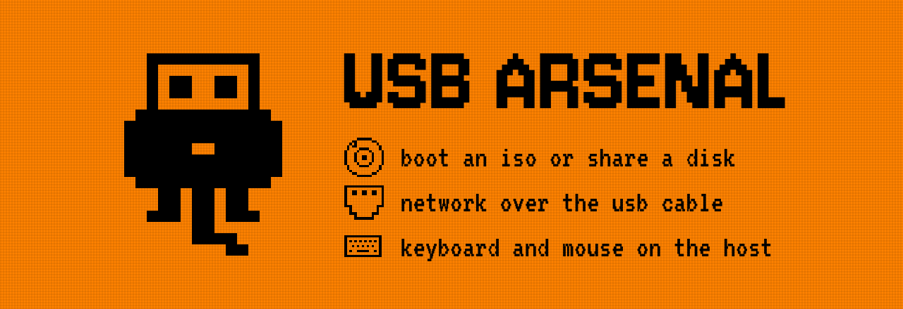
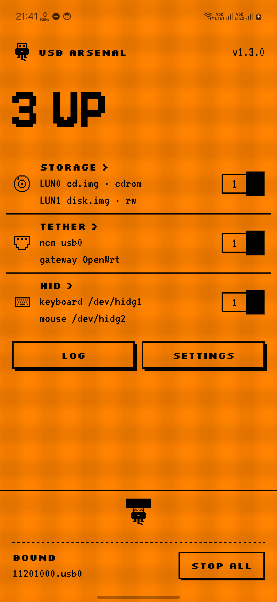
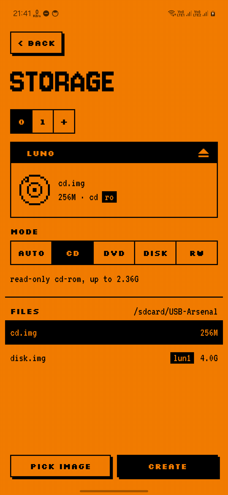
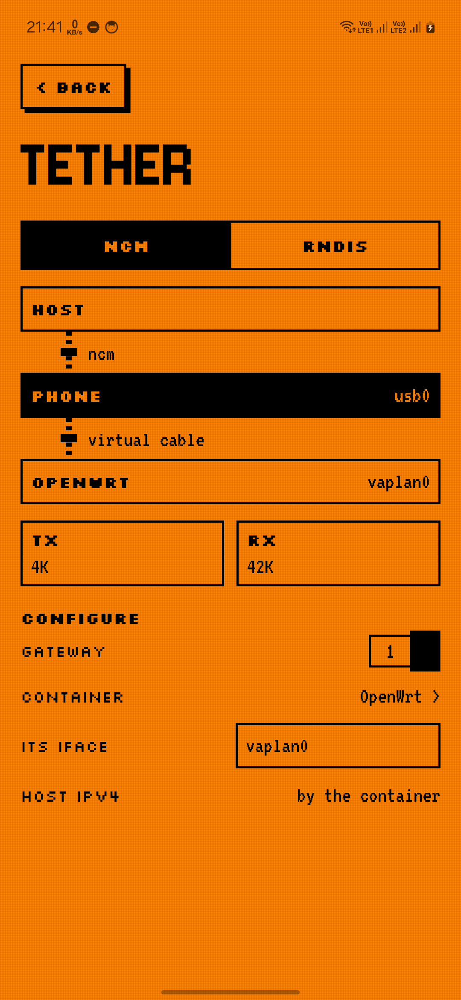
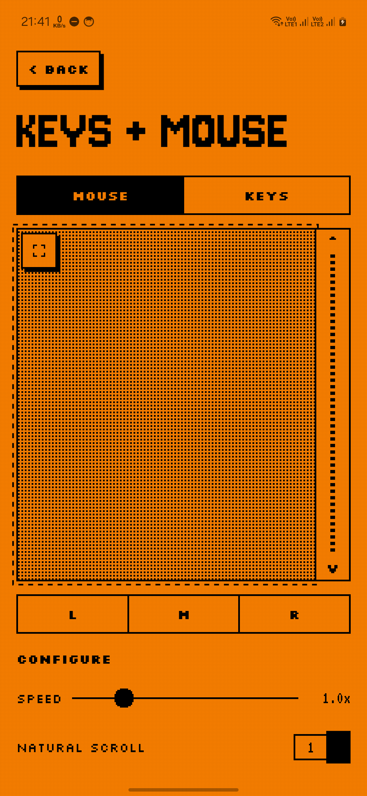
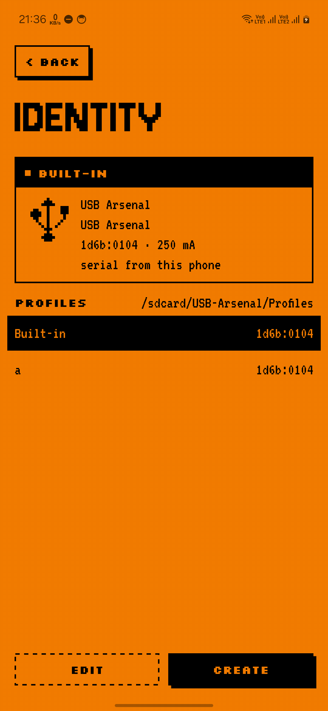
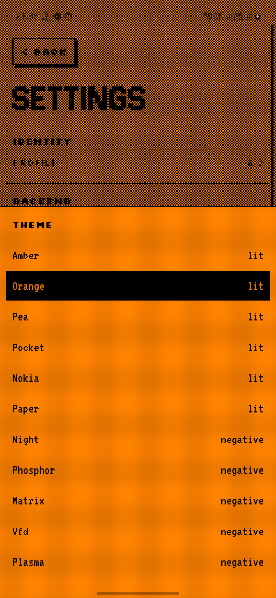

# USB Arsenal

USB Arsenal turns a rooted Android phone into several USB devices at once, over the one
cable: a USB drive or CD-ROM holding any image, a network adapter that shares the phone's
internet, and a keyboard and mouse that the phone drives.

**There is no kernel module to install.** One static binary drives the kernel's own USB
gadget drivers through configfs, and gives the port back to Android when it is done, so ADB
and MTP return. The app installs that binary and runs it for you.

## What you get

- **Boot a computer from an ISO on your phone.** A plain ISO appears as a CD-ROM, a hybrid
  ISO or a USB image as a disk, and a Windows ISO past the CD-ROM limit as a DVD. The mode
  is picked from the image, and you can swap in another image while the drive is live.
- **A pen drive.** Any image file, read-only or writable, up to eight drives at once.
- **USB tethering that just works.** NCM, or RNDIS for older Windows, with DHCP and NAT
  built in, IPv6 included. Or hand the link to an OpenWrt container and let it be the router.
- **A keyboard and a mouse.** A trackpad and keys in the app, typed straight into the
  computer. Any program on the phone can drive them too.
- **All of it at once.** Storage, network and HID share the cable, and each can be added
  or removed without disturbing the others.
- **Your own identity.** Vendor and product IDs, names, serial and power draw come from
  profiles you edit in the app.
- **Fails safe.** The port is handed back after every command, error, crash or kill, and
  `Stop all` recovers whatever was left.
- **Eleven LCD themes**, from the amber default to Game Boy green and a negative display.

The same binary runs on a Linux board with a USB device port, and inside a privileged
[Droidspaces](https://github.com/ravindu644/Droidspaces-OSS) container.

## Requirements

- A rooted phone on Android 8.0 or newer. **KernelSU is recommended**; Magisk and APatch
  work with the same module.
- A kernel built with `CONFIG_USB_CONFIGFS` and the functions you want. The app checks
  this before it installs anything and says what your kernel has. Samsung's 4.x kernels
  need the patches in [kernel requirements](docs/kernel-requirements.md).

## Get started

1. Install the APK from the [latest release](https://github.com/ravindu644/USB-Arsenal/releases/latest),
   grant it root, and let it install the backend.
2. Put an ISO or a disk image in `/sdcard/USB-Arsenal`, open **Storage** and pick it.
3. Flip the switch on Home and plug the phone into a computer.

Everything the app does, a root shell can do with `usb-arsenal` ([usage](docs/usage.md)).
Linux boards and the KernelSU module are in the [installation guide](docs/installation.md).

## Screenshots

<table>
  <tr>
    <td width="33%" align="center"> Home</td>
    <td width="33%" align="center"> Storage</td>
    <td width="33%" align="center"> Tether</td>
  </tr>
  <tr>
    <td width="33%" align="center"> Keys + mouse</td>
    <td width="33%" align="center"> Identity</td>
    <td width="33%" align="center"> Themes</td>
  </tr>
</table>

## Security

> [!WARNING]
>
> USB Arsenal runs as root and controls the phone's USB port.
>
> Anyone who can write to a `/dev/hidg*` node can type on the computer it is plugged
> into. The nodes are `0660 root` by default; widen that only on purpose.
>
> A profile can borrow a real vendor's USB IDs. That is your choice to make.

## Documentation

| Page | What it covers |
|------|----------------|
| [The app](docs/app.md) | Setup, every screen, keys and TalkBack. |
| [Installation](docs/installation.md) | The KernelSU module, a manual install, Linux boards. |
| [Usage](docs/usage.md) | Every `usb-arsenal` command and option, with examples. |
| [Tethering](docs/tethering.md) | NAT mode, OpenWrt gateway mode, the host side. |
| [Containers](docs/containers.md) | Running USB Arsenal inside a container. |
| [Identity profiles](docs/identity.md) | Vendor and product IDs, names, serial, defaults. |
| [Kernel requirements](docs/kernel-requirements.md) | Kernel options, Samsung quirks, the patches in `kernel-patches/`. |
| [Troubleshooting](docs/troubleshooting.md) | Symptoms, causes and fixes. |

Developer notes (architecture, kernel research, the design language, roadmap) live in
[docs/developer](docs/developer/).

## Credits

- The Linux USB gadget subsystem: `f_mass_storage`, `f_hid`, `f_ncm`, `f_rndis` and
  configfs do the real work.
- [Droidspaces](https://github.com/ravindu644/Droidspaces-OSS): the networking code
  (netlink, DHCP, NAT) and the installer come from it, by the same author.
- VirtualAP, whose managed mode inspired the OpenWrt gateway mode.
- DriveDroid, which showed a phone can boot a PC.
- [Jersey 10](https://fonts.google.com/specimen/Jersey+10), [Silkscreen](https://fonts.google.com/specimen/Silkscreen)
  and [VT323](https://fonts.google.com/specimen/VT323), the app's faces, under the
  [SIL Open Font License 1.1](https://scripts.sil.org/OFL).

## License

[GNU General Public License v3.0](./LICENSE). Copyright (C) 2026
[ravindu644](https://github.com/ravindu644).
